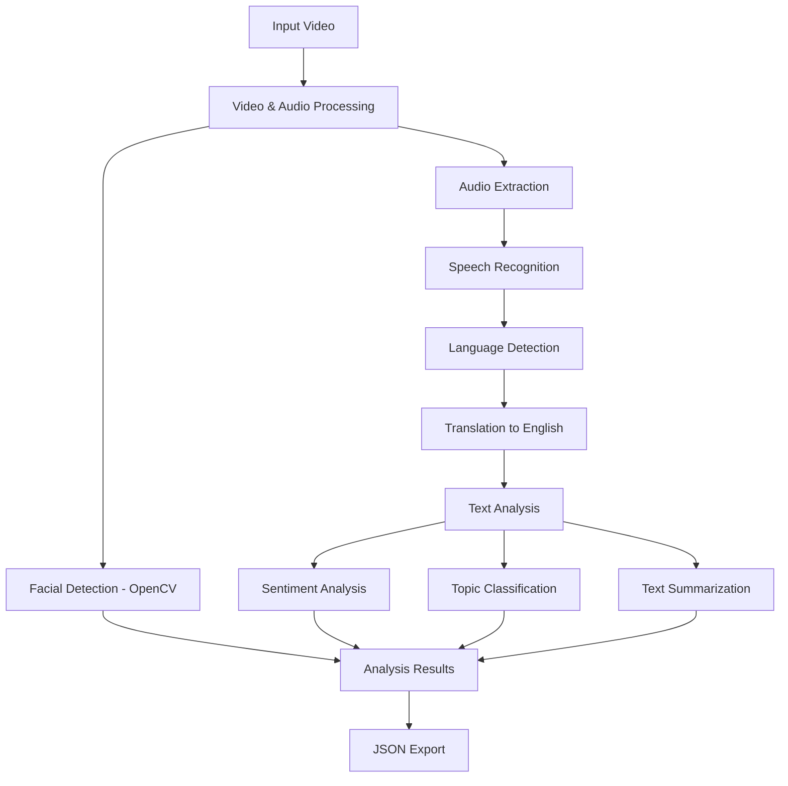

# 🎬 Video Analyzer AI | Local Video Intelligence Engine

<p align="center">
  
</p>

<p align="center">
  <strong>An AI-powered local video analysis tool combining Computer Vision, NLP and Speech Recognition.</strong>
</p>

<p align="center">
  <a href="https://drive.google.com/file/d/1zAf9SWUrQMaPjoY8qmKUTohbxwEKQ9kS/view?usp=sharing">
    
  </a>
</p>

<p align="center">
  
  
  
  
  
</p>

---

## 📌 Overview

**Video Analyzer AI** is a powerful and autonomous local video analysis tool developed in Python. It combines Artificial Intelligence techniques, Computer Vision, Natural Language Processing (NLP), and Speech Recognition to extract meaningful information from video files.

Unlike cloud-based solutions, this version performs its analysis directly on the local machine, without uploading video files to external cloud storage.

> 💡 The system transforms raw video content into structured insights, including speech transcription, sentiment analysis, facial detection, topic classification, and automatic summarization.

---

## 🎬 Project Demo

<p align="center">
  <a href="https://drive.google.com/file/d/1zAf9SWUrQMaPjoY8qmKUTohbxwEKQ9kS/view?usp=sharing">
    
  </a>
</p>

---

## ✨ Key Features

| Feature | Description |
|---|---|
| 🗣️ Speech-to-Text | Extracts audio and transcribes speech using Google Speech Recognition. |
| 🌍 Language Detection & Translation | Supports English, French, and Arabic, with automatic translation into English for analysis. |
| 🎭 Sentiment Analysis | Identifies dominant emotions: Happy, Sad, Angry, and Neutral. |
| 👤 Facial Detection | Uses OpenCV to detect the presence of human faces in videos. |
| 🏷️ Topic Classification | Categorizes video content into topics such as Sports, Politics, Technology, War, and Culture. |
| 📝 Automatic Summarization | Generates concise summaries of video content. |
| 💾 JSON Export | Automatically saves extracted metadata and analysis results in a structured JSON file. |

---

## ⚙️ How It Works

The application combines multiple AI components to analyze video content:



---

## 🛠️ Technologies & Tools

| Category | Technologies |
|---|---|
| Programming Language | Python |
| Computer Vision | OpenCV |
| Speech Recognition | Google Speech Recognition |
| NLP | Text Processing, Sentiment Analysis |
| Deep Learning | PyTorch, Transformers |
| Data Processing | NumPy |
| Output Format | JSON |

---

## 📋 Prerequisites

Before running the project, make sure you have:

- Python 3.8 or higher.
- An active internet connection for automatic dependency installation and online speech recognition/translation services.

---

## 🚀 Installation

The project is designed to be simple to install. The script automatically handles missing dependencies during its first execution.

**1. Clone the repository**

```bash
git clone YOUR_REPOSITORY_URL
cd YOUR_PROJECT_FOLDER
```

**2. Run the application**

```bash
python ultra_simple_video_analyzer_local.py
```

The script automatically installs missing libraries, including NumPy, OpenCV, PyTorch, Transformers, and other required dependencies.

---

## ⚙️ Configuration

By default, the application searches for video files in:

```python
C:/Users/layla/Videos
```

To analyze videos from another directory:

**1.** Open `ultra_simple_video_analyzer_local.py`.

**2.** Locate the constructor inside the `UltraSimpleVideoAnalyzer` class:

```python
def __init__(self, video_dir="C:/Users/layla/Videos"):
```

**3.** Replace the default path with your preferred directory:

```python
def __init__(self, video_dir="./mes_videos"):
```

---

## ▶️ Usage

Open a terminal in the project directory and execute:

```bash
python ultra_simple_video_analyzer_local.py
```

The application will process the available videos and generate structured analysis results in JSON format.

---

## 📂 Project Highlights

- Local video processing without uploading video files to cloud storage.
- Integration of multiple AI techniques into a single Python application.
- Multilingual speech processing (English, French, and Arabic).
- Automated extraction of meaningful information from unstructured video content.
- Structured JSON output for further analysis and integration.

---

## 🎯 Project Objective

The main objective of Video Analyzer AI is to demonstrate how different Artificial Intelligence technologies can be combined to transform unstructured multimedia content into meaningful, organized, and machine-readable information.

---

<p align="center">
  <strong>🎬 Video Analyzer AI</strong><br/>
  <i>Turning Videos into Structured Intelligence with AI.</i>
</p>
